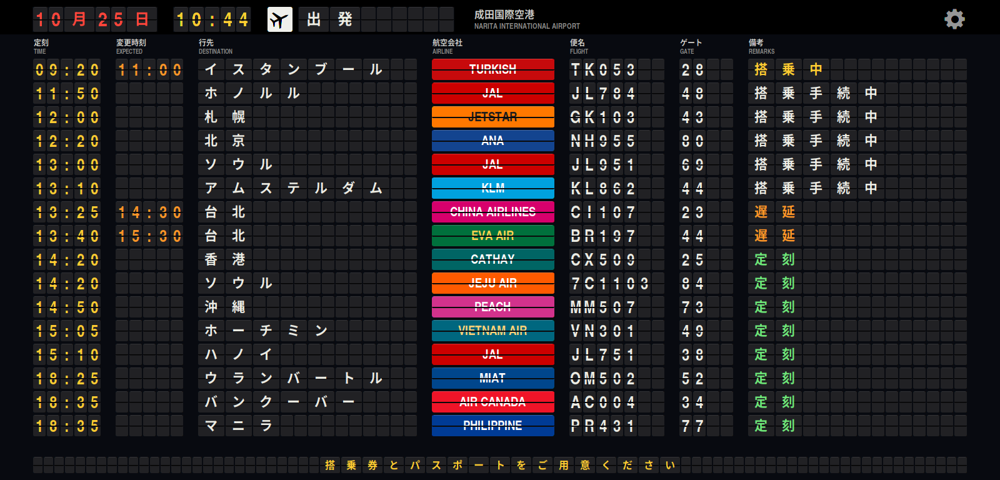
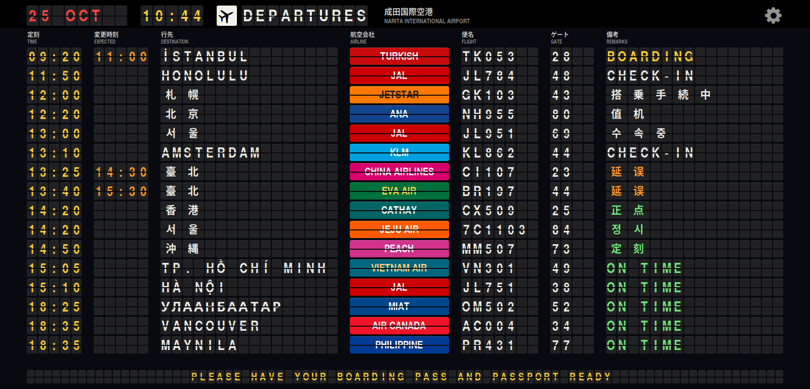
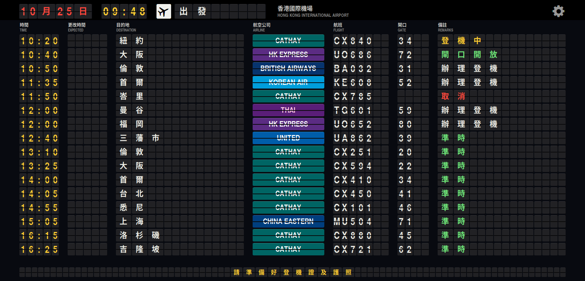
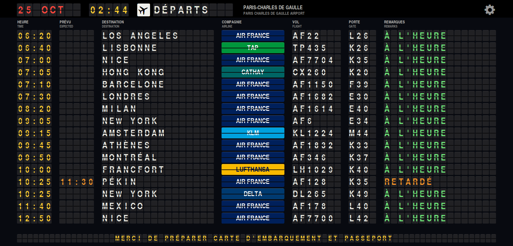
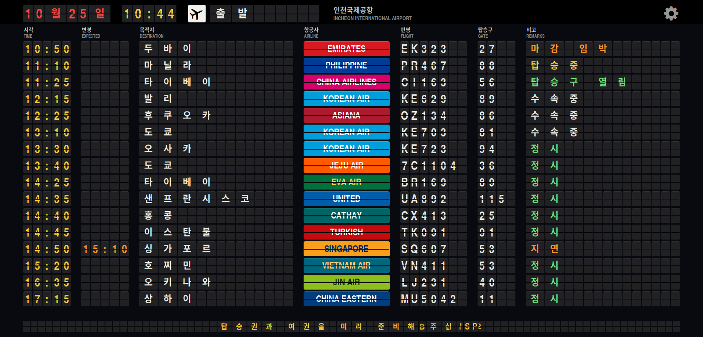

# R Departures

[English](README.md) | **日本語** | [한국어](README.ko.md)

Haiku/RenkuOS 用の空港出発案内板です。ウィンドウ枠なしの全画面で表示します。
文字の一つ一つがパタパタ (反転フラップ) で、内容が変わると別の文字を経てめくれ、
一行ずつ順に切り替わります。航空会社の欄は、その航空会社の色のフラップ一枚です。



## pkgman でインストール

| Haiku | リポジトリの追加 |
| --- | --- |
| 32 ビット x86 (x86_gcc2) | `pkgman add-repo https://pkgman.rainygirl.com/x86_gcc2` |
| x86_64 | `pkgman add-repo https://pkgman.rainygirl.com/x86_64` |
| arm64 | `pkgman add-repo http://pkgman.rainygirl.com/arm64` |

```sh
pkgman install rdepartures
```

**Deskbar -> Applications** から **R Departures** を起動します。フラップの
フォント (TeX Gyre Heros Condensed Bold) もパッケージが一緒にインストールします。

`pkgman add-repo` が `Operation not supported` で失敗する場合、そのイメージの
ネットワークキットには TLS がありません。`https://` の代わりに `http://` を
使ってください。

## 空港

仁川 (ICN)、成田 (NRT)、香港 (HKG)、ヒースロー (LHR)、シャルル・ド・ゴール (CDG)、
ミラノ・マルペンサ (MXP)、ニューヨーク JFK (JFK)、サンフランシスコ (SFO)。
右上の歯車から選ぶと、次に起動したときもその空港で始まります。

案内板はその空港の現地時刻 (夏時間を含む) で動き、8 秒ごとに言語が変わります。

1. 空港のある国の言語
2. 英語 (その国の言語が英語でない場合)
3. 行先ごとにその国の言語 -- ソウルは 서울、台北は 臺北、アテネは ΑΘΗΝΑ。
   備考も、案内板にその言葉があればその言語で表示します。





便は実在の路線に、もっともらしい便名・ゲート・時刻を付けたものです。時刻表は毎日
同じように作られ、いくつかの遅延と欠航は日付で決まります。リアルタイムのデータでは
ありません。備考は時刻に応じて搭乗手続中、ゲートオープン、搭乗中、最終案内、
搭乗締切、出発済と変わります。



## キー

| キー | |
| --- | --- |
| Esc、Q | 終了 |
| 右矢印、スペース | 次の空港 |
| 左矢印 | 前の空港 |

マウスポインターは 3 秒動かさないと隠れます。

## ソースからビルド

Haiku で:

```sh
make install
```

`RDepartures` をビルドして `~/config/non-packaged/apps/R Departures` にコピーし、
案内板のフォント (TeX Gyre Heros Condensed Bold) を
`~/config/non-packaged/data/fonts/otfonts` に入れます。フォントは再起動後に
使われます。コードは C++98 なので、32 ビット x86 (gcc2) ハイブリッドでも既定の
`g++` でビルドできます。

Docker のある作業用マシンでは `tools/cross-build.sh all` で `dist/x86/` (gcc2)、
`dist/x86_64/`、`dist/arm64/` をクロスビルドします。

`RDepartures --snapshot board.png --size 1600x768 --airport CDG` は画面なしで
案内板を描いてファイルに保存します。案内板が起動中だとそちらに渡されるので、
先に終了してください。

## 無関係であること

航空会社の名前と色は案内板らしく見せるために使っています。ロゴは含まれておらず、
どの航空会社・空港もこのプログラムを承認していません。

## AI の利用について

R Departures は AI コーディングツール (Anthropic の Claude) の支援を受けて
開発しました。

## ライセンス

コードは MIT。`fonts/texgyreheroscn-bold.otf` (TeX Gyre Heros、B. Jackowski、
J. M. Nowacki) は GUST Font License (`fonts/GUST-FONT-LICENSE.txt`) です。
