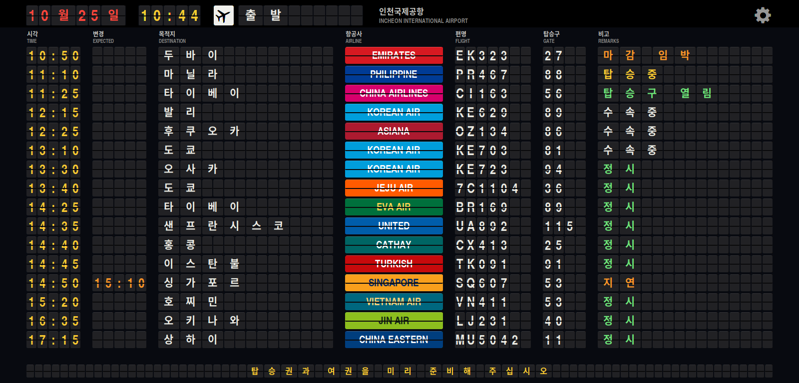

# R Departures

[English](README.md) | [日本語](README.ja.md) | **한국어**

Haiku/RenkuOS용 공항 출발 안내판입니다. 창 테두리 없이 전체 화면으로 나옵니다.
글자 하나하나가 플립(split flap)이라, 내용이 바뀌면 다른 글자들을 거쳐 넘어가며 한
줄씩 차례로 바뀝니다. 항공사 칸은 항공사 색상으로 된 플랩 한 장입니다.



## pkgman으로 설치

| Haiku | 저장소 추가 |
| --- | --- |
| 32비트 x86 (x86_gcc2) | `pkgman add-repo https://pkgman.rainygirl.com/x86_gcc2` |
| x86_64 | `pkgman add-repo https://pkgman.rainygirl.com/x86_64` |
| arm64 | `pkgman add-repo http://pkgman.rainygirl.com/arm64` |

```sh
pkgman install rdepartures
```

**Deskbar -> Applications**에서 **R Departures**를 실행합니다. 플랩 폰트(TeX Gyre
Heros Condensed Bold)도 패키지가 함께 설치합니다.

`pkgman add-repo`가 `Operation not supported`로 실패하면 그 이미지의 네트워크
킷에 TLS가 없는 것입니다. `https://` 대신 `http://`를 사용하세요.

## 공항

인천(ICN), 나리타(NRT), 홍콩(HKG), 히드로(LHR), 샤를 드골(CDG), 밀라노 말펜사(MXP),
뉴욕 JFK(JFK), 샌프란시스코(SFO). 오른쪽 위 톱니바퀴를 눌러 고르면 다음 실행 때도
그 공항으로 시작합니다.

안내판은 그 공항의 현지 시각(서머타임 포함)으로 움직이고, 8초마다 언어가 바뀝니다.

1. 공항이 있는 나라의 언어
2. 영어(그 나라 언어가 영어가 아닐 때)
3. 목적지마다 그 나라의 언어 -- 서울은 서울, 타이베이는 臺北, 아테네는 ΑΘΗΝΑ.
   비고도 안내판에 그 말이 있으면 그 언어로 나옵니다.


항공편은 실제 노선에 그럴듯한 편명, 탑승구, 시각을 붙인 것입니다. 시간표는 매일
같게 만들어지고, 지연과 결항 몇 편은 날짜에 따라 정해집니다. 실시간 데이터는
아닙니다. 비고는 시각에 따라 수속중, 탑승구 열림, 탑승중, 마감 임박, 탑승 마감,
출발로 바뀝니다.


## 키

| 키 | |
| --- | --- |
| Esc, Q | 종료 |
| 오른쪽 화살표, 스페이스 | 다음 공항 |
| 왼쪽 화살표 | 이전 공항 |

마우스 포인터는 3초 동안 움직이지 않으면 숨겨집니다.

## 소스에서 빌드

Haiku에서:

```sh
make install
```

`RDepartures`를 빌드해 `~/config/non-packaged/apps/R Departures`에 복사하고,
안내판 폰트(TeX Gyre Heros Condensed Bold)를
`~/config/non-packaged/data/fonts/otfonts`에 넣습니다. 폰트는 다시 시작한 뒤부터
쓰입니다. 코드는 C++98이라 32비트 x86(gcc2) 하이브리드에서도 기본 `g++`로
빌드됩니다.

Docker가 있는 작업용 머신에서는 `tools/cross-build.sh all`로 `dist/x86/`(gcc2),
`dist/x86_64/`, `dist/arm64/`를 크로스 빌드합니다.

`RDepartures --snapshot board.png --size 1600x768 --airport CDG`는 화면 없이
안내판을 그려 파일로 저장합니다. 안내판이 이미 떠 있으면 그쪽으로 넘어가므로 먼저
종료하세요.

## 관계 없음

항공사 이름과 색상은 안내판처럼 보이게 하려고 쓴 것입니다. 로고는 넣지 않았고,
어느 항공사나 공항도 이 프로그램을 승인하지 않았습니다.

## AI 고지

R Departures는 AI 코딩 도구(Anthropic의 Claude)의 도움을 받아 개발되었습니다.

## 라이선스

코드는 MIT. `fonts/texgyreheroscn-bold.otf`(TeX Gyre Heros, B. Jackowski,
J. M. Nowacki)는 GUST Font License(`fonts/GUST-FONT-LICENSE.txt`)입니다.
